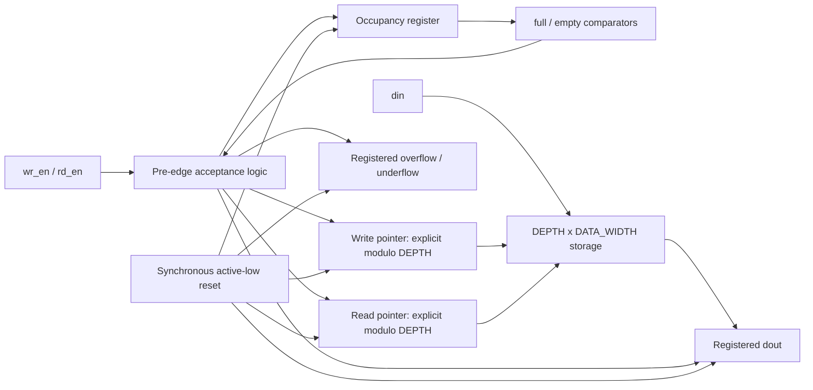

# Architecture and source walkthrough

## Reproducible block diagram

The memory is intentionally absent from the reset fanout. Occupancy determines
which stored entries are valid. clk drives every state update shown above.

## rtl/sync_fifo.v

There is one production module, `sync_fifo`. Input/output widths and parameters
form its interface; local parameters derive safe pointer and count widths.
Combinational comparisons derive flags from count. Acceptance equations determine
which operations are legal before a rising edge. One clocked process resets
control/output state, generates error indicators, conditionally updates memory
and pointers, and increments/decrements/holds occupancy.

Holding dout and pointers is intentional sequential behavior, not an inferred
combinational latch. The explicit last-address comparisons prevent depth-five
pointers from entering addresses five, six, or seven. Sized increments and a
count width that includes DEPTH avoid accidental arithmetic overflow.

When full, wr_ptr and rd_ptr identify the same location. The read captures its
old value while the write schedules its replacement. For DEPTH=1 this is the
normal simultaneous operation, which is why that case has dedicated testing.

## tb/tb_sync_fifo.sv

The testbench contains the clock generator, parameterized DUT, compact array
reference model, deterministic PRNG, transaction task, output checker, coverage
accumulators, directed tests, randomized phase, optional VCD dump, and watchdog.
`step` is the single drive/check path. `fill` and `drain` generate higher-level
sequences. `check_outputs` compares dout/count/flags/errors both before and after
edges. Data bits are individually drawn from the PRNG, so width 65 is exercised
beyond a single 32-bit random value.

## Automation modules

| Script | Responsibility |
|---|---|
| common.ps1 | Tool discovery, process environment, logging, matrix, JSON helper |
| check_tools.ps1 | Inventory and version evidence; GTKWave existence check |
| run_lint.ps1 | Icarus Verilog-2005 compile checks and strict Verilator RTL lint |
| run_simulations.ps1 | Compile once per configuration, execute deterministic seeds, check PASS and exit |
| run_regression.ps1 | Longer random regression preset |
| generate_waveforms.ps1 | Default-configuration waveform preset |
| run_synthesis.ps1 | Generate Yosys scripts, synthesize, export statistics/netlists, simulate netlists |
| run_all.ps1 | Run child PowerShell stages and stop on a failed stage |
| write_summary.ps1 | Check the result matrix, summarize actual counts, hash the source files |
| clean.ps1 | Validate and remove fixed generated directories; supports -WhatIf |

Generated `synth.ys` files are standalone reproducible synthesis inputs. The
`memory.json` and `memory_stat.json` snapshots precede memory-to-flop mapping;
final cell statistics follow generic synthesis. This separates inferred storage
from its eventual technology-independent implementation.
